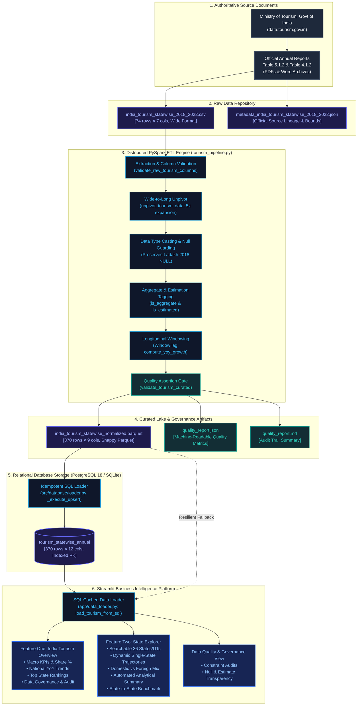

# TravelWise — End-to-End Data Lineage & Provenance Architecture

> **Platform:** TravelWise Data Engineering Platform  
> **Documentation Scope:** Full Data Lineage from Government Sources to Interactive Streamlit Dashboards

---

## 1. Visual Data Lineage Architecture (Mermaid Diagram)

---

## 2. Component Lineage Breakdown

### Node 1: Official Sources to Raw CSV
- **Ingestion Origin:** Compiled from annual reports published by the Market Research Division, Ministry of Tourism, Govt. of India.
- **Archive Path:** [`data/raw/tourism/`](file:///d:/Travel%20and%20tourism/data/raw/tourism/)
- **Primary Raw CSV:** [`data/raw/tourism/india_tourism_statewise_2018_2022.csv`](file:///d:/Travel%20and%20tourism/data/raw/tourism/india_tourism_statewise_2018_2022.csv)
- **Schema:** 7 columns: `State/UT`, `Category`, `2018`, `2019`, `2020`, `2021`, `2022`.
- **Row Count:** 74 rows (37 entities × 2 categories).

### Node 2: PySpark Normalization & Processing
- **Execution Script:** [`src/pipeline/run_tourism_pipeline.py`](file:///d:/Travel%20and%20tourism/src/pipeline/run_tourism_pipeline.py)
- **Engine Module:** [`src/pipeline/tourism_pipeline.py`](file:///d:/Travel%20and%20tourism/src/pipeline/tourism_pipeline.py)
- **Core Operations:**
  1. Header and column validation (`validate_raw_tourism_columns`).
  2. Wide-to-long unpivoting across 5 years ($74 \times 5 = 370$ rows).
  3. Safe type casting to `BIGINT` and genuine historical null preservation (Ladakh 2018).
  4. Adding `is_aggregate = (state == 'Total India')` to isolate national totals.
  5. Tagging `is_estimated = True` for Maharashtra and Delhi in 2022 per official compendium footnotes.
  6. Computing Year-over-Year growth percentage via PySpark analytical window function:
     $$\text{yoy\_growth\_pct} = \frac{\text{visit\_count} - \text{prev\_visit}}{\text{prev\_visit}} \times 100$$
  7. Quality assertions gate (`validate_tourism_curated`).

### Node 3: Curated Parquet Lake
- **File Destination:** [`data/processed/tourism/india_tourism_statewise_normalized.parquet`](file:///d:/Travel%20and%20tourism/data/processed/tourism/india_tourism_statewise_normalized.parquet)
- **Compression:** Snappy Columnar Parquet.
- **Quality Artifacts Generated:**
  - Machine-readable audit: [`data/processed/tourism/quality_report.json`](file:///d:/Travel%20and%20tourism/data/processed/tourism/quality_report.json)
  - Human-readable audit: [`data/processed/tourism/quality_report.md`](file:///d:/Travel%20and%20tourism/data/processed/tourism/quality_report.md)

### Node 4: Relational SQL Persistence
- **Loading Module:** [`src/database/loader.py`](file:///d:/Travel%20and%20tourism/src/database/loader.py)
- **Table Destination:** `tourism_statewise_annual`
- **Dialect Handling:**
  - **PostgreSQL:** Uses `sqlalchemy.dialects.postgresql.insert` with `ON CONFLICT (state, category, year) DO UPDATE`.
  - **SQLite:** Uses `INSERT OR REPLACE` with transactional batching.
- **Verification:** Verified 370 rows with 0 duplicate keys on `(state, category, year)`.

### Node 5: Streamlit Analytics Platform
- **Data Access Helper:** [`app/data_loader.py`](file:///d:/Travel%20and%20tourism/app/data_loader.py)
- **Primary Data Source:** SQL Database via `load_tourism_from_sql()` (PostgreSQL or local SQLite store).
- **Fallback Layer:** If the SQL database service is unavailable, automatically falls back to curated Parquet lake directly.
- **User Views:**
  1. **India Tourism Overview:** Executive macro KPIs, national trajectories, top state rankings, and zero double-counting guarantee.
  2. **State Explorer:** Dedicated deep-dive for any of the 36 verified States/UTs with automated narrative synthesis, domestic vs foreign visitor mix, and side-by-side benchmarking.
  3. **Data Quality & Governance:** Transparent validation reports and schema constraint auditing.
